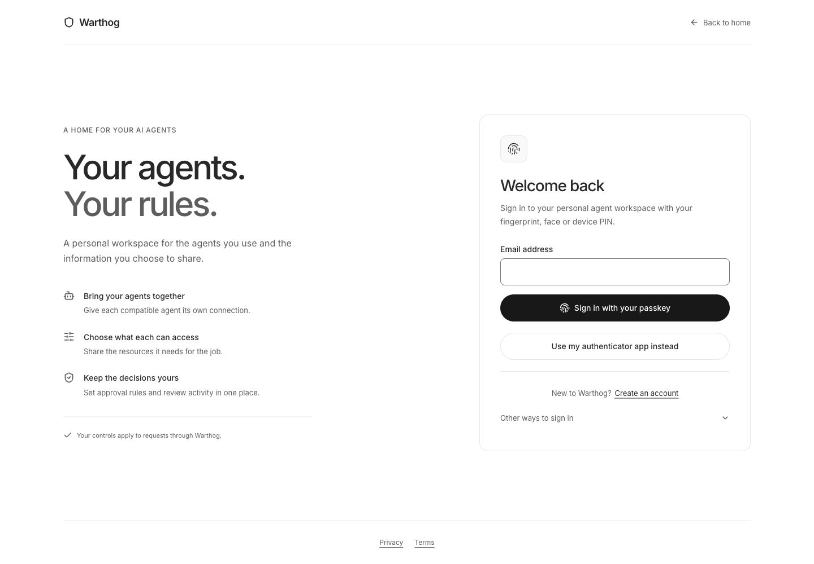
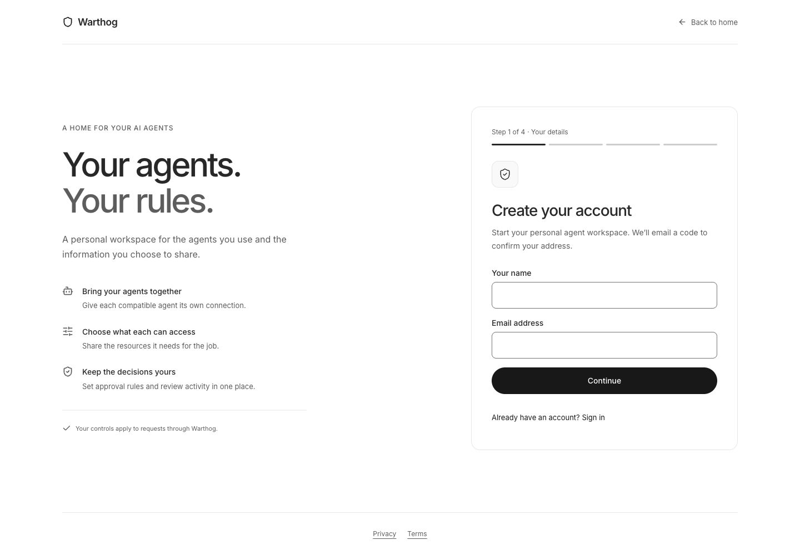
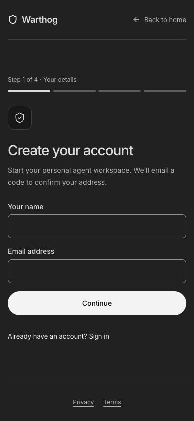

# Public navigation and account-entry polish

The founder requested sticky public navigation with gradual section scrolling,
clear routes back to the homepage from sign-in and signup, and more mature account
pages consistent with the rest of Warthog.

## Changes

- Public navigation remains visible while scrolling. Section links are also
  available on phones. Native fragment navigation scrolls smoothly unless the
  visitor requests reduced motion. Scroll-container clearance accounts for the
  header and safe area, including when keyboard focus moves down the page.
- `AuthScreen` provides a bounded form, consistent typography, neutral surfaces,
  a supporting desktop introduction and an explicit **Back to home** link on
  every step. Phones prioritise the form. Shared recovery/device/reset views keep
  the same account-entry frame.
- Signup identifies the four stages: details, email, sign-in method and recovery.
  Passkey and authenticator setup share the third stage. Required recovery-code
  confirmation and warnings remain visible.
- Sign-in separates the main action from alternate/recovery routes using a native
  keyboard-accessible disclosure. Account creation stays visible. Inline errors
  describe the relevant field or form; cancellation/delivery failures do not
  declare the email invalid. Switching back to a passkey or restarting
  signup preserves the validated destination.

Authentication controllers, handlers, session lifetimes, cookies, required factors
and the recent session-aware entry behavior are unchanged. There is no database
migration, new dependency, external asset or production account-data change.

## Verification

- **5,234 tests passed** in the initial full run, with no failures, skips or
  cancellations. TypeScript and the production build/startup suite passed.
  Regression coverage checks explicit home links across all nine signup/sign-in
  states and destination preservation. The subsequent form-feedback correction
  passes all **206 focused checks**, including a regression case for passkey
  cancellation and delivery failures; final full verification is recorded with
  the release outcome.
- **63 authentication layout cases** used 13 synthetic states across phone and
  desktop, with additional breakpoint, error, long-email and short-landscape
  cases. A 320px sweep used actual 24/12/20/12px safe-area padding. Light and dark
  themes were checked. No document/child overflow or undersized checked controls
  were observed.
- **20 public-page layout cases** covered 320, 360, 390, 640, 768, 1023, 1024,
  1440 and 1920px plus 844 × 390 landscape, in both themes. All section links
  remained available and the document stayed within its viewport.
- In the running application, section clicks produced observable intermediate
  scroll positions before settling. Desktop content stopped below the 88px
  header; the narrow safe-area case stopped below the header at 24px. Reduced
  motion used immediate native navigation. Both account pages returned to `/`;
  the recovery disclosure opened with Enter and visible focus, and switching
  back to a passkey retained the destination.
- Captured browser warning/error logs were empty. Temporary browser overrides,
  tabs, local servers, fixtures and the disposable preview database were removed.
  The original local environment file remains byte-for-byte unchanged.

Screenshots below are from the local production build. The tests do not establish
hardware-passkey acceptance, authenticator QR scanning, native device keyboard
behavior or assistive-technology speech. Source/image CI and production outcome
are recorded separately during release.

## Visual evidence

