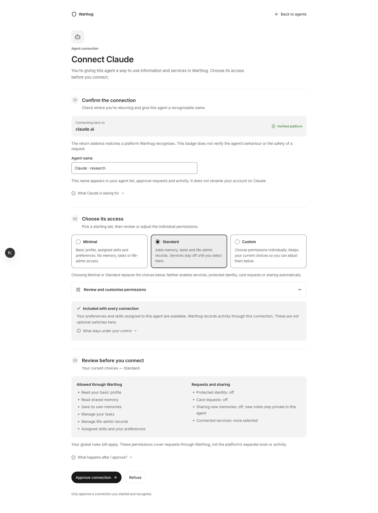
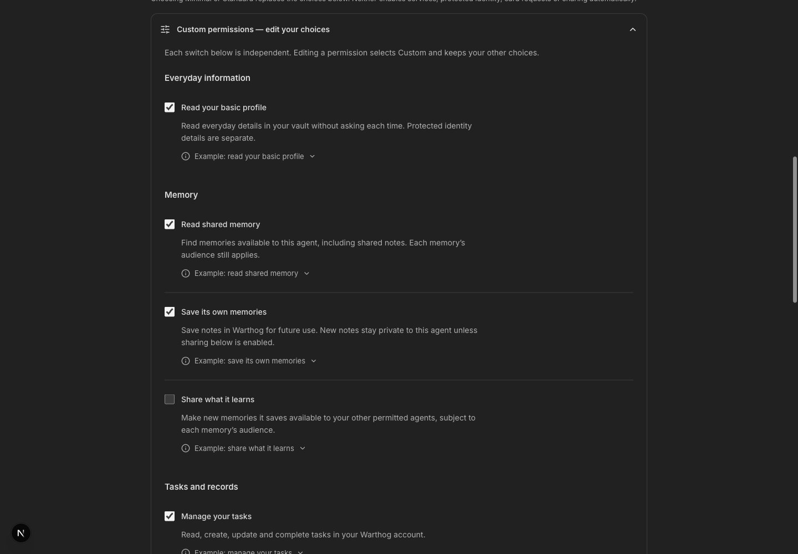
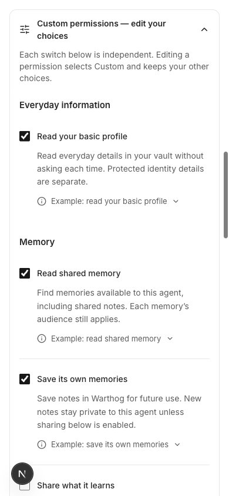

# Connection consent review — 12 November 2026

The founder reported that consent still used a sparse, narrow layout and unclear
permission labels. Minimal and Standard did not explain their differences, and
Custom did not visibly introduce editing. The related-route review found a second
concrete omission: access-key setup offered Custom without any individual controls.

## Findings and changes

| Area | Finding | Change |
| --- | --- | --- |
| OAuth consent | One undifferentiated form, vague presets and little explanation | Bounded layout with connection identity, access selection and review sections |
| Custom | Same initial state as Standard, without a clear editing transition | Opens grouped controls; edits select Custom and preserve other choices |
| Memory grants | UI claimed saving followed reading, but saving still came from the template | Independent read/save controls, explicit submission and server mapping |
| Access keys | Custom had no editable grants before issuing a credential | Shared permission editor and review; server persists explicit overrides |
| Callback trust | Badge could be read as agent endorsement; non-default port hidden | Plain explanation of badge limits and full host/port display |
| Failed submission | Redirect discarded the draft; React action reset could desynchronise controls and review | Persistent error with preserved choices; guarded event-driven submission |
| Expired request | Isolated notice with no onward navigation | Titled recovery state, restart steps, Agents and setup-guide links |
| Agent defaults and saved permissions | Duplicated, inconsistent terminology | Shared descriptions explaining concrete capabilities and preset differences |

The review covered the connection journey and checked the surrounding route
composition: connection guide, compatibility help, account entry/device flows and
global error/not-found pages already use their existing design primitives. This
is not a claim that every application state has been exhaustively browser-tested.

## Design and scope

The editor groups everyday information, memory, tasks/records, sensitive requests
and services. Explanations remain beside controls; optional examples use info
icons and native disclosures that work by keyboard and touch. Preset cards and
the final review describe what will actually be granted.

Skills and preferences are explained with their audience limits. Service changes
still ask first. Protected identity and card releases still need approval; the
budget copy no longer implies control over charges made outside Warthog. Global
rules, connection-only scope and the limits of disconnecting are explicit.

No migration, new dependency or OAuth protocol change is introduced. Existing
agents are not modified. Session identity, member scope, pending-request binding,
callback validation and transaction boundaries remain server-enforced. New
connections can explicitly decline memory saving independently of reading.
Access-key issuance remains one-time and guarded against repeated submission.

See the [connection design guidance](../../design/agent-connection-consent.md).

## Browser verification

**45 layout cases** passed across 320, 390, 768, 1024, 1440 and 1920px plus short
landscape, both themes, expanded consent/access-key forms, empty services and
expired requests. A 320px case used actual emulated safe-area insets and a long,
unrecognised callback. No document/content overflow or undersized checked controls
was observed.

**16 interaction checks** passed: Custom opens the editor, independent memory
controls, Minimal's grants, preserved Custom choices and name, automatic Custom
selection without losing focus, invalid-budget prevention, exact form submission,
error-state preservation, refusal with an invalid budget, duplicate-submit guard,
keyboard examples, narrow safe-area reflow, access-key choices/error recovery and
a real Next server-action redirect. Captured warning/error logs were empty.

Browser evidence uses a local development build with synthetic fixtures. No
production connection, grant or credential was created. Native device keyboards,
screen-reader speech and a real provider handshake were not exercised. Temporary
fixture routes, environment, preview database and browser overrides were removed.

## Automated verification

Node 22 TypeScript validation passes. The focused permission and consent checks
passed 55 tests. The complete local run executed 5,241 tests: 5,240 passed and one
older static-render assertion expected Create to be enabled before hydration.
That assertion was corrected to verify the safe initial state; all 18 tests in
its file then passed. Browser checks confirmed the hydrated button is usable.
There were no other failures, cancelled tests or skipped tests. The runtime source
was unchanged during these runs.

Main CI will verify the exact committed source again before image publication.
The release outcome is recorded separately during delivery.

## Screenshots

