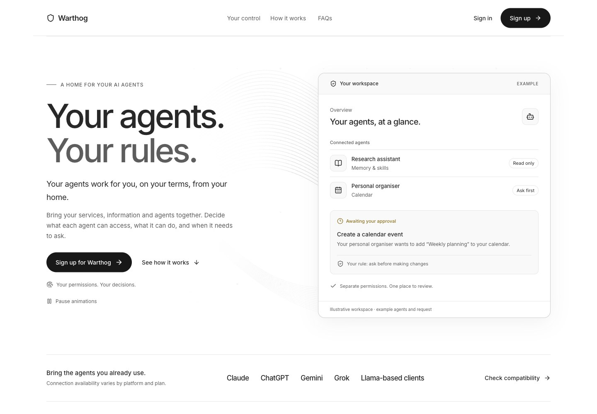
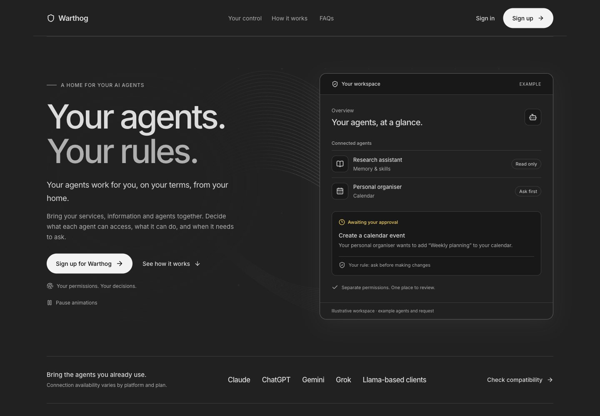
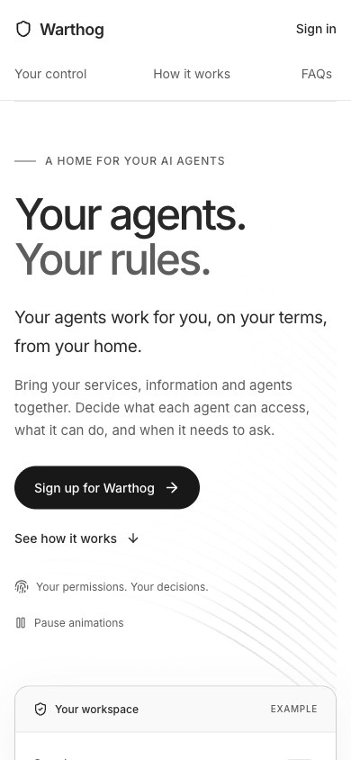
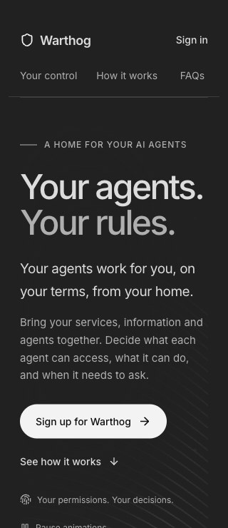

# Marketing motion review — 12 November 2026

The founder requested React Bits-inspired movement and a more interactive
background, specifically on the public marketing page.

## Design and implementation

[Threads](https://reactbits.dev/backgrounds/threads),
[Dot Grid](https://reactbits.dev/backgrounds/dot-grid) and
[Animated Content](https://reactbits.dev/animations/animated-content) informed the
visual direction: flowing neutral lines, sparse drifting dots, gentle pointer
response and short section entrances. The SVG artwork and implementation are
original; no React Bits source or runtime dependency is included.

The hero and closing section have bounded decorative backgrounds. CSS animates
three SVG groups when the section is visible. Fine mouse pointers gently steer
the artwork using one scheduled update per frame; there is no continuous
JavaScript rendering loop. The illustrative workspace and its sample activity
remain still and explicitly labelled as examples.

Section entrances move 14px once over 650ms, preserving full text opacity.
Actions have small arrow movements, resource icons respond to hover, and native
FAQ disclosure remains keyboard accessible. The FAQ navigation and Terms links
now also meet the 44px minimum target width on the marketing page.

## Accessibility and scope

- A named 44px pause/play control stops background motion and entrances. Its
  preference persists for the current browser tab; unavailable storage does not
  prevent the control working. Space is reserved before hydration.
- Reduced-motion and forced-colour preferences take precedence. High-contrast
  mode removes decoration; backgrounds pause outside the viewport and when the
  document is hidden. Effects clean up observers, listeners, scheduled frames and
  active entrance animations when disabled or unmounted.
- Artwork is hidden from assistive technology and does not receive pointer
  events. All content and native links/disclosures are available in the server
  response; no text starts hidden or waits for animation to become usable.
- Touch scrolling, sticky navigation and native fragment scrolling are preserved.
  Authentication pages, signed-in views, session behavior, dependencies and
  production data models are unchanged. No external assets, tracking or audio
  are introduced.

## Verification

- All **5,236 local tests** passed with zero failures, skips or cancellations.
  The final build, typecheck and **14 focused landing/public-entry checks** passed.
  Existing preview tests now scope the ban on pretend controls to the illustration;
  the new real animation control remains outside it.
- **20 layout cases** covered 320, 360, 390, 640, 768, 1023, 1024, 1440 and 1920px
  plus 844 × 390 landscape, in light and dark themes. No document/content overflow
  or undersized checked navigation/action/disclosure targets were observed.
- **13 interaction checks** passed: pause, persisted pause, keyboard resume,
  reduced motion, forced colours, smooth-scroll/header clearance with offscreen
  suspension, keyboard FAQ, actual 320px safe-area padding, changing animation
  frames, simulated hidden-document suspension, pointer steering and unchanged
  sign-in/signup navigation. Captured browser warning/error logs were empty.
- The automation browser kept both test tabs visible, so native background-tab
  visibility was not observed. The visibility handler was exercised with a local
  document override that was restored immediately. Native device keyboards,
  screen-reader speech and hardware passkeys were not exercised.
- Browser overrides and tabs were reset/closed. The isolated preview and database
  were removed, and the original local environment file remains byte-identical.

Source/image CI, production verification and cleanup passed; see the
[release record](../marketing-motion-release-2026-11-12.md). Screenshots below use
the local production build and synthetic illustration content; a still image
cannot demonstrate animation timing.

## Visual evidence

