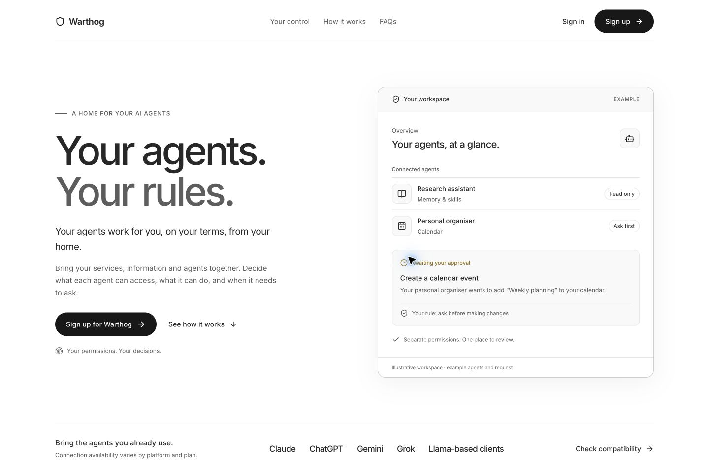
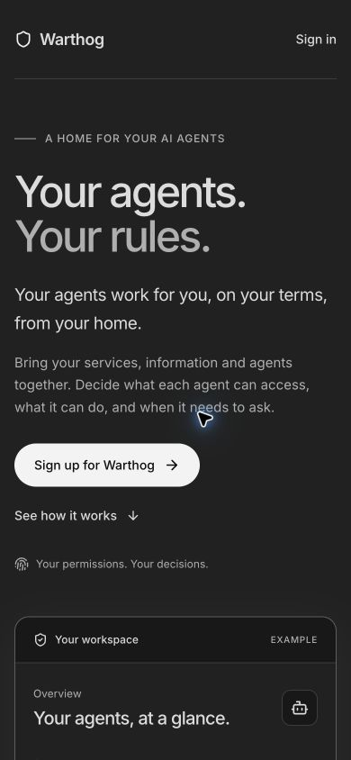

# Session-aware entry and public landing

The sign-in page previously showed the credential form even when the browser
still held a valid session. Visiting `/home` in the same production browser
confirmed the account was already authenticated. This was an entry-page defect,
not evidence that persistent session cookies had been lost.

`/signin` now verifies the existing session and redirects to its validated return
path, or Home. `/` sends returning members to Home and shows the redesigned
landing to signed-out visitors. Both use the same database-backed expiry and
revocation check as protected routes. The 14-day idle window, 30-day absolute
window and secure persistent cookie attributes are unchanged.

The public page now has a bounded desktop hero, a labelled illustrative
workspace, an explanation of agent controls and resources, setup steps, native
FAQs and real account/help links. It retains Warthog's neutral design tokens and
states the boundaries of its control and platform compatibility. No dependency,
database migration, provider integration or signed-in layout changes are needed.

## Verification

- Regression cases use real migrated session rows: valid, missing, malformed,
  forged, idle-expired and revoked sessions; safe return links, external paths,
  arrays and sign-in loops. Anonymous entry without a cookie avoids the database.
- Nine checks against the built, running app verify authenticated redirects,
  byte-preserved callback parameters, unsafe-return fallback, public access and
  unchanged secure cookie attributes. Only a disposable local account was used.
- Twenty browser combinations cover 320, 360, 390, 640, 768, 1023, 1024, 1440 and
  1920px, plus 844 × 390 landscape, in both light and dark themes. No document or
  child overflow and no undersized navigation/disclosure targets were found.
- An additional 320px check verifies actual 24/12/20/12px safe-area padding and
  reduced-motion preference. Keyboard checks cover the skip link, visible focus
  and Enter to toggle FAQs. Signup and signin links reach their real forms.
- Browser console: no captured warnings or errors. Native device keyboards and
  assistive technologies were not exercised; browser emulation is not a substitute
  for those device checks.

The first full run found four older tests that invoked sign-in without a request
context. Their assertions are preserved; their harness now supplies a real Next
anonymous request. The corrected 25-case sign-in/session group passes. The final full run passes
all **5,232 tests**, with no failures, skips or cancellations; typecheck and the
production build/boot suite also pass. The
[release record](../public-entry-release-2026-11-11.md) documents successful
production deployment, live verification and completed runner cleanup.

## Visual evidence

