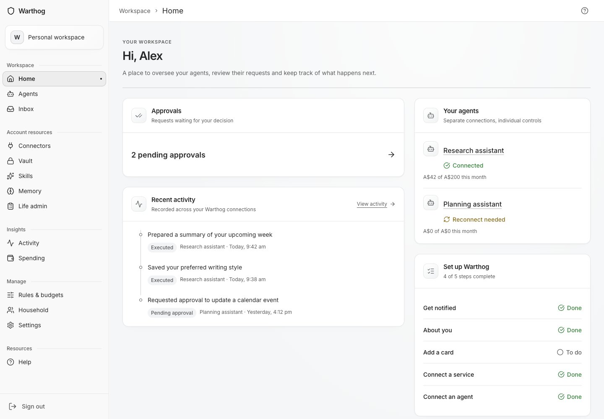
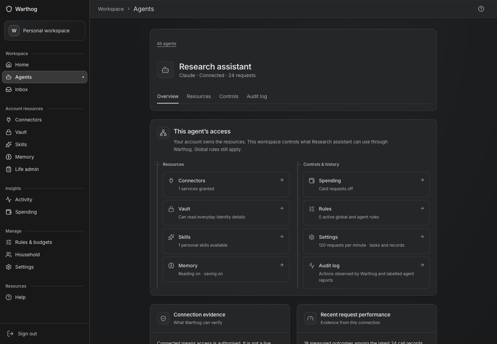
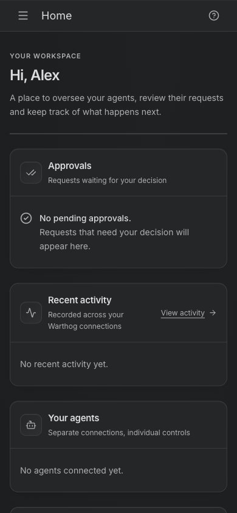

# Workspace depth review — 12 November 2026

The signed-in app had a consistent neutral visual language, but its canvas,
sections and settings occupied almost the same visual plane. The founder asked
for more depth, texture, grouping and topology inside the application.

## Result

- An app-scoped neutral canvas, opaque panels, fine edges, inner highlights and
  shallow shadows distinguish navigation, tasks and supporting details.
- Home separates approvals and an activity timeline from agents, setup progress
  and reminders. Setup completion and all outcomes still use existing data.
- Agent overviews organise existing destinations into Resources and Controls &
  history, with branch rails and a small static texture behind the introduction.
  These are navigation relationships, not live traffic or new grants. Connection
  evidence and request performance remain distinct, with their original caveats.
- Agent rows, permissions, Settings and resource lists share the same surface
  hierarchy. The reusable heading and panel primitives preserve real headings,
  native links, form state, confirmations and controls.
- [Workspace depth guidance](../../design/workspace-depth.md), the design skill
  and contributor instructions describe how to maintain this treatment.

Marketing, sign-in, sign-up, consent, server behaviour, dependencies and cloud
configuration are unchanged. Work took place in an isolated managed checkout,
based on main `9ec551d`, coordinated with the dependency/recovery worker.

## Validation

- TypeScript check: passed after removing the temporary preview route and its
  generated Next types. The fixture used synthetic data and is not shipped.
- Final focused Home/checklist/agent overview checks: **29 passed**. The existing
  dashboard test now identifies the relocated setup section by its new neighbour.
- Full `npm test`: **5,259 passed**, zero failed, cancelled or skipped, including
  the production build and all nine build/boot checks.
- **144 layout cases passed** using static rendering of the actual components:
  eight screens in both themes at 320, 390, 768, 1023, 1024, 1440 and 1920px with
  long content, plus empty states at 320 and 1440px. Each retained a single page
  heading and avoided document horizontal overflow. See the
  [layout results](static-layout-results.json).
- **Six additional checks passed:** four short landscape/safe-area layouts,
  keyboard focus through the agent access map, and forced-colour/reduced-motion
  rendering. Texture disappeared under forced colours, borders remained visible,
  and keyboard focus had a 2px outline. See [special results](special-layout-results.json).
- **Five hydrated checks passed:** mobile drawer focus containment, Escape focus
  return, drawer closure at the desktop breakpoint, keyboard tab selection with
  URL updates, and preservation of a catalogue search draft across tab switches.
  See [interaction results](interactive-results.json).
- Final shared-card variants retain separate standard and read-only backgrounds
  in both themes: light `#ffffff` / `#f1f3f4`, dark `#252628` / `#2d2f31`.
  Explicit card colour utilities remain effective; depth does not override them.

Browser checks used local synthetic fixtures; no production account was changed.
Automation timeouts were followed by state inspection, not counted as app
failures or successful checks. This is not a native-device, mobile-keyboard or
screen-reader certification. Both owned preview servers, temporary source route
and local environment file were removed; browser overrides and owned tabs were
cleaned up. Private logs remain separate from source.

## Captures

These captures use the actual components rendered statically. Hydrated behaviour
was checked separately. All names, activity and balances are synthetic.

